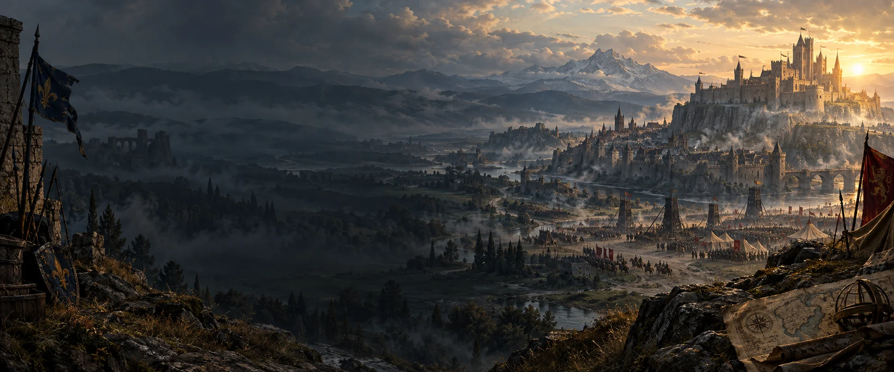
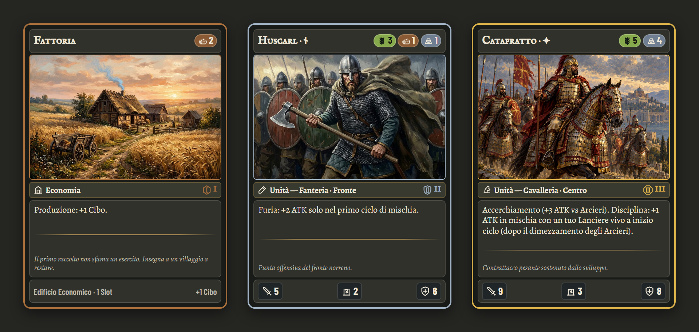

# The Epochs

**Tre Ere. Una città da difendere. Un avversario da sorprendere.**

Un gioco di carte strategico per due giocatori, in italiano, tra sviluppo della
città, eserciti schierati in segreto e assedi decisivi. Investi nelle risorse,
prepara la tua formazione e scopri se hai letto le intenzioni dell'avversario.

**[Gioca alla beta nel browser →](https://epoch-7u1.pages.dev/)**

## Costruisci oggi, conquista nell'Era successiva

Ogni partita attraversa **tre Ere**: crescono le risorse, arrivano nuove carte e
le scelte iniziali preparano le battaglie finali. Un edificio in più può sostenere
il tuo esercito domani, ma occupa lo stesso spazio delle truppe che ti servono ora.

Schiera le carte coperte, scegli quando fermarti e tieni pronta un'istantanea per
il momento della rivelazione. Poi gli eserciti si affrontano: gli arcieri aprono
lo scontro, i lancieri fermano le cariche e la cavalleria minaccia la retroguardia.
Chi prevale sul campo può assediare la città nemica.

**Abbatti il Centro Città avversario per vincere subito, oppure arriva alla fine
della terza Era con il tuo Centro Città più integro.**

## Le carte raccontano la tua strategia

Scegli tra **Regni feudali, Norreni e Bizantini**: eserciti misti, razzie aggressive
o difese imperiali. Combina economia, unità, strutture e istantanee in un mazzo
capace di accompagnarti attraverso tutte e tre le Ere.

Parti da un mazzo pronto oppure crea il tuo nel **Deck Builder**. L'**Archivio
Carte** ti permette di esplorare illustrazioni, abilità e combinazioni.

## Cosa puoi provare nella beta

- **Partite contro il computer**, con tre avversari tra cui scegliere.
- **Sfide locali a due sullo stesso dispositivo**, con passaggi di turno riservati.
- **Tutorial guidato e regolamento**, per imparare dalle prime mosse all'assedio.
- **Mazzi pronti e personalizzati**, da costruire, salvare, importare ed esportare.

La beta è dedicata al **gioco offline**; il multiplayer online è in arrivo.
Apri il gioco con una connessione e lascia completare il primo caricamento:
potrai poi riaprirlo senza rete per giocare nelle modalità locali. Puoi anche
installarlo dal browser sui dispositivi compatibili.

**[Scegli il tuo mazzo e prova la beta →](https://epoch-7u1.pages.dev/)**

Per avviare il progetto sul tuo computer o contribuire allo sviluppo, consulta
la [guida tecnica](docs/DEVELOPMENT.md).
